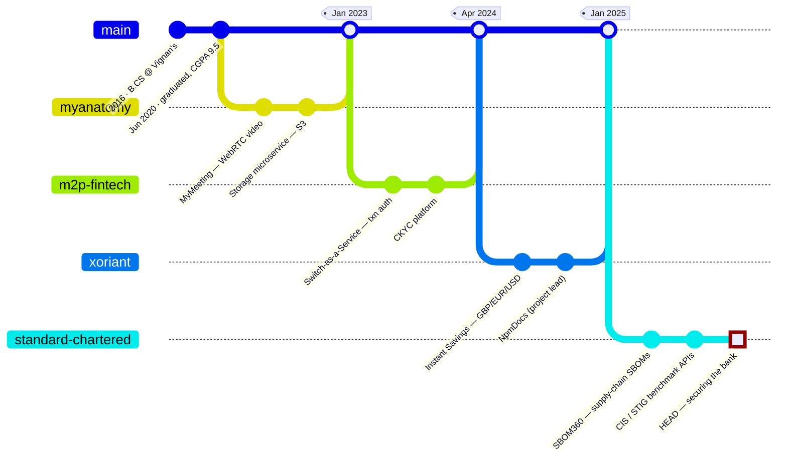
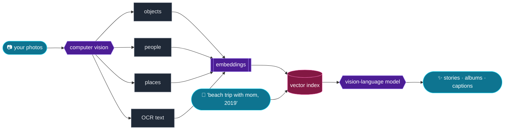

<p align="center">
  <a href="mailto:iprasannareddy20@gmail.com"></a>
  
</p>

```console
$ systemctl status prasanna.service
● prasanna.service — Senior DevSecOps Full-Stack Security Engineer
     Loaded: loaded (/etc/careers/fintech.conf; enabled)
     Active: active (running) since Aug 2020; 6y+ ago
   Main PID: 2025 (standard-chartered-gbs)
      Tasks: sbom360, security-benchmark-apis, secure-code-tooling
   Security: sbom · cyclonedx · cdxgen · syft · trivy · cis/stig benchmarks
    Workers: python · fastapi · node · typescript · java · spring-boot · graphql
      Queue: kafka · rabbitmq · bullmq · sqs/sns — always draining, never dropping
     Memory: postgres · mongodb · mysql · dynamodb · redis
     Fork:   mira (local-first visual intelligence) — side project, running hot 🔥

Nov 17 09:00 prod prasanna[2025]: INFO  sbom generated · 0 unknown dependencies
Nov 17 09:01 prod prasanna[2025]: WARN  curiosity exceeded threshold → spawning LLM experiments
```

## 📈 `SELECT impact FROM career;`



## 🌳 `git log --graph career`



<details>
<summary><b>📦 <code>git show --stat</code> — what each commit actually contains</b></summary>
<br/>

| Commit | What it does | Stack |
|---|---|---|
| **SBOM360** · Standard Chartered | Automated SBOMs (CycloneDX) for in-house apps, vendor binaries, containers, OS & DB layers — aligned to SLSA / NTIA | `Python` `cdxgen` `syft` `trivy` `CycloneDX` |
| **Security benchmark reporting** · Standard Chartered | REST APIs + dashboard for CIS & STIG benchmark and security-inventory reporting | `Python` `FastAPI` `PostgreSQL` `Postman` |
| **Instant Savings Account** · Xoriant | Fixed-rate savings across GBP, EUR & USD balances, with recurring transfers | `Lambda` `DynamoDB` `GraphQL` `SNS` `CloudWatch` `Mambu` |
| **NpmDocs** · Xoriant *(lead)* | Discover and browse NPM package documentation | `Node.js` `React` `Redux` `TypeScript` `RabbitMQ` |
| **Switch as a Service** · M2P | Transaction lifecycle — authorization, rule validation, limit checks; request encryption via AWS KMS | `Spring Boot` `PostgreSQL` `MySQL` `MongoDB` `Kafka` `KMS` |
| **CKYC** · M2P | Fetch, update & store customer KYC records | `Node.js` `Express` `React` `BullMQ` `MySQL` `Cluster` |
| **MyMeeting** · MyAnatomy | Secure 1:1 video calls with moderator controls | `Socket.io` `Simple Peer` `TypeScript` `React` `MongoDB` |
| **Storage Microservice** · MyAnatomy *(lead)* | Uploads, deletion history & large-file processing | `S3` `Node.js` `BullMQ` `Redis` `MongoDB` |

</details>

## 🧰 `npm ls --depth=0`

<p align="center">
  <br/>
  <br/>
  
</p>

## 🔭 `./mira --explain` &nbsp;<sub>side project, in progress</sub>

> Turn an ordinary folder of photos into a **private, searchable memory** — no cloud required.



## 🐍 `tail -f contributions.log`

<picture>
  <source media="(prefers-color-scheme: dark)" srcset="https://raw.githubusercontent.com/prasanna3000/prasanna3000/output/github-snake-dark.svg"/>
  
</picture>

<details>
<summary><b>🎓 <code>cat ~/.credentials</code></b> <sub>(the safe kind)</sub></summary>
<br/>

- **Bachelor of Computer Science** — Vignan's Deemed To Be University · Jun 2016 – Jun 2020 · CGPA **9.5 / 10**
- **AWS Solutions Architect – Associate** — SimpliLearn
- **MongoDB Authentication & Authorization** — MongoDB University

</details>

```diff
$ git log -1 --format=%B philosophy
- Good software is about making things work.
+ Good software is about understanding why it needs to exist in the first place.
```

<p align="center"><sub>building systems · learning constantly · breaking things occasionally (in staging, mostly)</sub></p>
